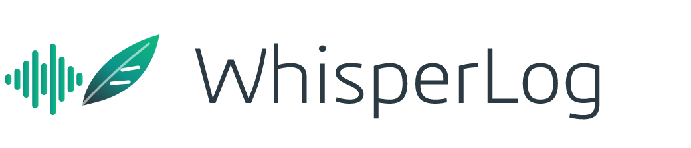

<p align="center"></p>

# WhisperLog

En Windows-app (Electron + React) som spelar in möten – digitala på alla plattformar och fysiska – transkriberar dem på svenska och engelska och skriver mötesprotokoll med Google Gemini.

## Funktioner

- **Inspelning** av din mikrofon och datorns ljud (Teams, Zoom, Meet … oavsett plattform), eller en rumsmikrofon för fysiska möten. Paus vid lunch och fika. Fortsätter i bakgrunden från systemfältet.
- **Mötesdetektering** – notis (eller automatisk start) när ett program börjar använda mikrofonen.
- **Transkribering**, tre valbara motorer:
  - **Gemini Live** (standard) – transkriberar medan ni pratar; texten är klar i samma stund som mötet slutar.
  - **Gemini** – i efterhand med talaridentifiering och namn på varje röst.
  - **Lokalt (whisper.cpp)** – ljudet lämnar aldrig datorn; används även automatiskt som reserv.
- **Vem sa vad** – lokal röstigenkänning (sherpa-onnx, WeSpeaker) delar upp texten per röst: Talare 1, 2, 3 … Peka ut vem som pratar under mötet eller efteråt – alla repliker med samma röst får namnet. Fungerar även i efterhand på äldre möten ("Identifiera röster").
- **Protokoll** – Gemini skriver protokollet efter mötets agenda och följer tidigare protokoll som mall. Roller och bolag hämtas från mötet och mötesuppgifterna. Med en Word-mall (.docx) behålls sidhuvud, sidfot och loggor vid export ("Word enligt mall").
- **Minnesanteckningar** – eget, lättläst format med sammanfattning, ämnen, beslut och att göra.
- Redigera, exportera till Word/PDF eller kopiera.
- **Arkiv** – varje möte sparas med ljud, transkription, protokoll och bilagor.

## Kom igång

1. Ladda ner/bygg `WhisperLog.exe` och starta den.
2. **Inställningar** → klistra in din Google API-nyckel (aistudio.google.com → *Get API key*) och skriv ditt namn.
3. **Nytt möte** → välj digitalt/fysiskt, ev. deltagare, agenda och mall → **Starta inspelning**.
4. **Avsluta möte** → transkriptionen är klar → **Skapa protokoll**.

Arkivet ligger som standard i `Dokument\WhisperLog` (en mapp per möte).

## Utveckling

```
npm install
npm run dev     # Vite + Electron
npm run icons   # genererar logga och ikoner från scripts/brand.js
npm run dist    # bygger release/WhisperLog.exe (portabel)
```

Testa långa möten utan att sitta av dem: `WHISPERLOG_SIMULATE=<16 kHz WAV>` (+ `WHISPERLOG_SPEED`, `WHISPERLOG_APIKEY`) kör en fil genom hela inspelningskedjan i utvecklingsläget.

## Grafisk profil

Marin `#2B3A42`, ljus `#E8F0FE`, grön `#10B981`, teal `#0D9488`, grå `#6B7280`. Typsnitt: Inter och Geist. Logga och ikoner finns i `assets/brand/`.
